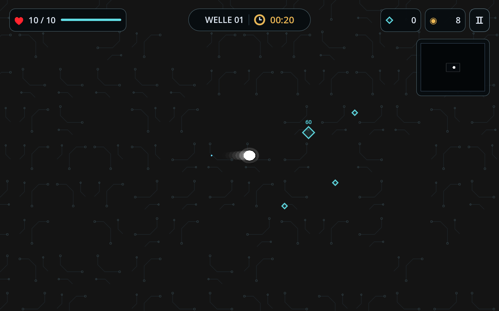
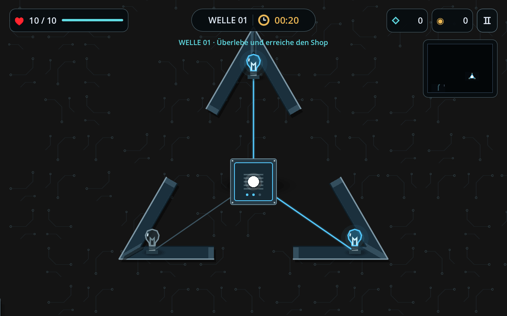
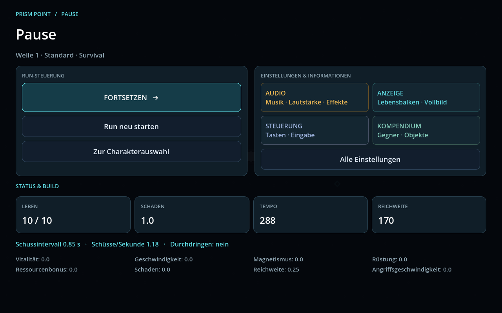
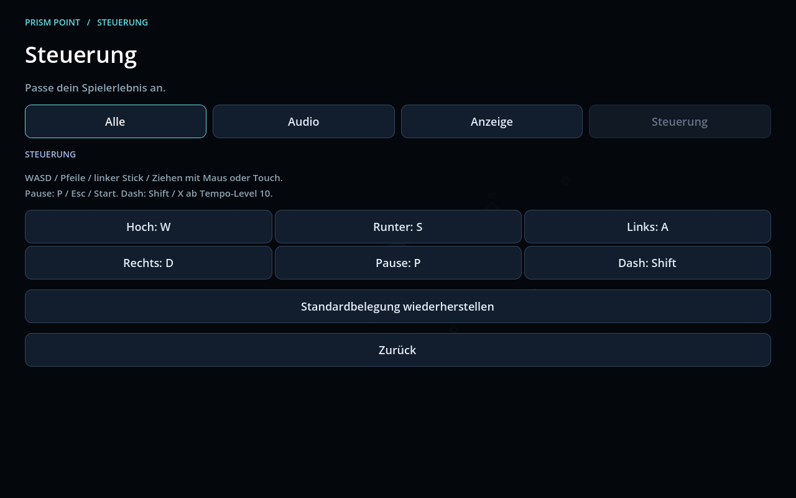

# Punkte, Bewegung und Pausenmenü

## Punkte mit gleichem Symbol und additiver Verschmelzung

HUD und Punkte auf dem Boden zeichnen jetzt dieselbe türkise Raute.
Punkte innerhalb von 72 Welteinheiten ziehen sich gegenseitig an. Sobald
sie nahe genug sind, werden ihre Werte addiert: **2 + 3 = 5**.
Die gemeinsame Raute wird größer und zeigt ihren Wert darüber an.
Ihre Größe ist begrenzt, damit sie das Spielgeschehen nicht verdeckt.

Vorhandene Ressourcenboni und Rundung bleiben beim Einsammeln exakt so
erhalten wie beim getrennten Aufsammeln. Die Verschmelzung erzeugt keinen
zusätzlichen Multiplikator. Herzen und Durchdringen-Boni bleiben separat.
Wände verhindern die Anziehung zwischen getrennten Bereichen.

Die Nachbarsuche verwendet räumliche Zellen und läuft zehnmal pro Sekunde.
Eine kompakte Häufigkeitstabelle bewahrt die ursprünglichen Werte, ohne
für jeden alten Punkt ein eigenes Objekt zu behalten. Im Integrationstest
wurden 5.000 überlappende Punkte zu einer Raute mit dem Wert 5.000 zusammengefasst.
Das reduziert die anschließende Zeichen- und Sammelarbeit; die tatsächliche
Bildrate hängt weiterhin von Hardware und Spielsituation ab.

## Dynamischere Bewegung

- Kurzes, weiches Beschleunigen mit unveränderter maximaler Charaktergeschwindigkeit.
- Schnelles Abbremsen und direkter Richtungswechsel.
- Kurze, weich ausblendende Nachbilder in der jeweiligen Charakterfarbe.
- Dezente Formänderung in Bewegungsrichtung, stärker während des Dashs.
- Sanft nachführende Kamera mit kleinem Blickvorlauf.

Die Bewegung wird zeitbasiert integriert; der Test prüft gleiche Wegstrecken
bei 30, 60 und 120 Updates pro Sekunde. Nachbilder sind begrenzt und verschwinden
im Stillstand. Beim Start einer Welle werden Schwung und Spur zurückgesetzt.

## Neue Wände am alten Monument

Die Metallwände des dreieckigen Schaltmoduls verwenden gemeinsame Innen- und
Außenecken. Dadurch schließen die Segmente bündig aneinander an. Die drei
Eingänge, die Druckplatte und die Ladung zu den blauen Lampen bleiben nutzbar.
Die Beschriftung unter der Druckplatte ist entfernt. Kollisionen und Minikarte
verwenden ebenfalls die neuen Wandformen.

## Pausenmenü mit Themenbereichen

Das neue Dashboard trennt Run-Steuerung, Einstellungen und Statusübersicht.
Die Schaltflächen haben echte Funktionen:

| Bereich | Funktionen |
| --- | --- |
| Run-Steuerung | Fortsetzen, neu starten, Charakterauswahl |
| Audio | Musik, Effekte, Lautstärken und Musiktitel |
| Anzeige | Gegner-Lebensbalken und Vollbild |
| Steuerung | Tastenbelegung ändern und Standardbelegung wiederherstellen |
| Kompendium | Gegner und Spielobjekte nachlesen |

Einstellungen und Kompendium kehren zur Pause desselben Runs zurück.
Timer und Kampf bleiben dabei angehalten. Alle Einstellungen sind auch
weiterhin zusammen über „Alle Einstellungen“ erreichbar.

## Geprüft

Godot 4.6.3: **152 Checks bestanden**, keine Engine- oder Scriptfehler.
Die Screenshots stammen aus dem echten Godot-Renderer. Das Ressourcenpaket
wurde exportiert und unabhängig vom Projektverzeichnis gestartet.
Das Bewegungsgefühl und die Balance in langen Runs bleiben subjektiv und
sollten beim Spielen zusätzlich beurteilt werden.
