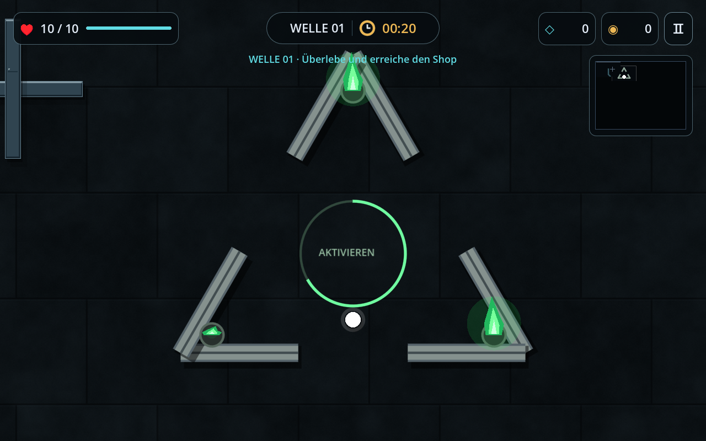
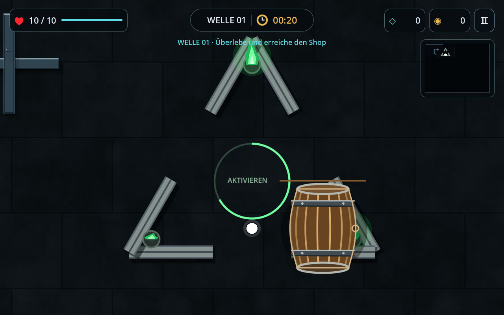
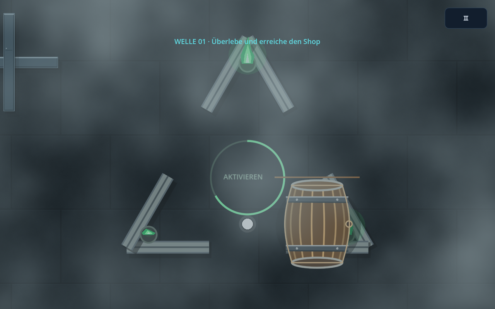
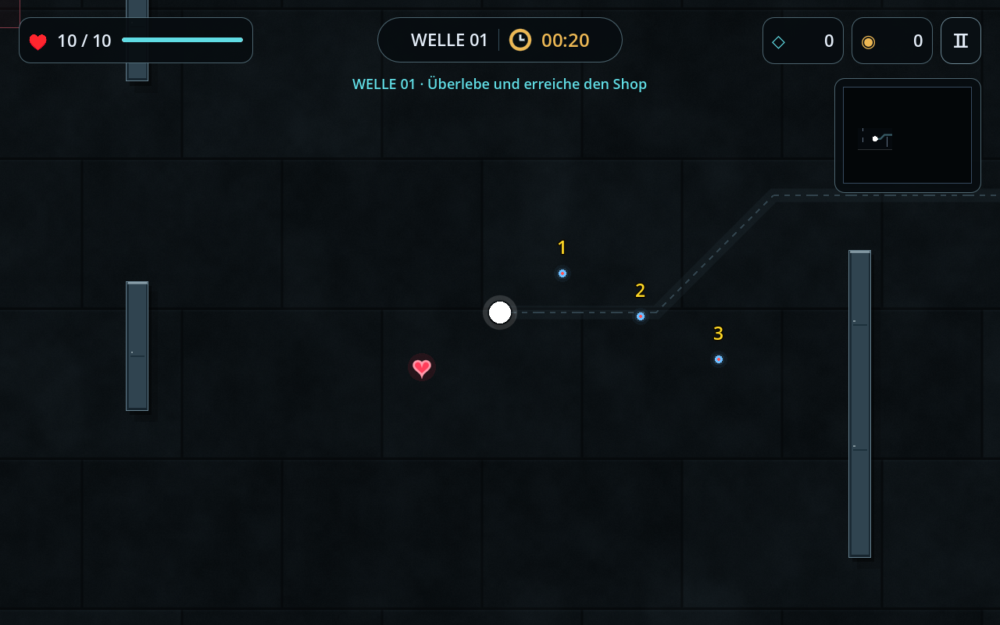

# Gameplay-Update

Umsetzung des Feedbacks vom 5. November 2026, geprüft mit Godot 4.6.3.

- **Dreiecksmonument:** Radius von 105 auf 360 Weltpixel vergrößert. Sechs
  kollidierende Steinsegmente bilden drei Seiten mit je einem 200 Pixel breiten
  Eingang. Spieler, Gegner, Navigation und Projektile berücksichtigen die Wände.
  Das zentrale Feld aktiviert nach 2,4 Sekunden Standzeit die Auswahl; drei
  animierte grüne Flammen zeigen den Fortschritt.
- **Minikarte:** Deckt den sichtbaren Kameraausschnitt auf und merkt sich
  erkundete Bereiche innerhalb der Welle. Unbekannte Wände, Wege und Ziele sind
  verborgen. Geometrie und Spieler verwenden dieselbe Welt-zu-Karte-Abbildung.
- **Nebel:** Weiche, langsam ziehende Wolkenschichten über die ganze Ansicht,
  ohne kreisförmige Taschenlampenkante. Timer, HP, Punktestand/Gold und Karte
  werden während des Nebels ausgeblendet; die Pause bleibt nutzbar.
- **Fassboss:** Gewölbter Holzkörper, Dauben, Metallreifen, Nieten und
  Fassdeckel. Die Dauben und der Spund drehen sich passend zur tatsächlich
  zurückgelegten Strecke und kehren bei Richtungswechsel ihre Drehrichtung um.
- **Endboss:** Kern von 1000 auf 2000 HP, alle sechs Knoten von 120 auf 240 HP.
- **Statuswerte:** Nur noch im Pausenmenü, einschließlich aller Upgrade-Level,
  Schaden, Bewegungstempo, Reichweite und tatsächlichem Schussintervall.
- **Combo:** Keine feste Anzeige unten mehr. Jeder Kill erzeugt eine gelbe,
  aufsteigende und ausblendende Zahl wie `3` an der Gegnerposition. Das Wort
  „Combo“ und das Multiplikationszeichen wurden im anschließenden UI-Update entfernt.
- **Neue Karten:** Jede Welle wählt eine andere Layout-Familie und verteilt
  neun verschiedene Wandstrukturen neu, mit wechselnder Größe und Ausrichtung.
  Spawn, Shop-Pfad und Monument-Eingänge bleiben begehbar.
- **Heilung:** Gegner haben 8% Chance auf ein rotes Herz für +1 HP. Kein
  Überheilen; bei vollen HP bleiben Herzen liegen. Shop und Wellenwechsel
  füllen die HP nicht auf. Ein neuer Run beginnt weiterhin mit vollen HP;
  gezielte Vitalitäts-Käufe behalten ihre Heilwirkung.

## Bilder aus dem nativen Renderer

## Prüfung

101 automatisierte Checks bestanden: 52 Basisprüfungen und 49 Regressionen,
ohne Engine-/Scriptfehler. Zusätzlich 13 Ansichten mit OpenGL/llvmpipe
gerendert und die betroffenen Darstellungen visuell geprüft. Die automatisierten
Checks testen auch alle drei Monument-Eingänge mit dem großen Tank, acht neue
Kartenlayouts und den HP-Verlauf über Shop und Wellenwechsel.
