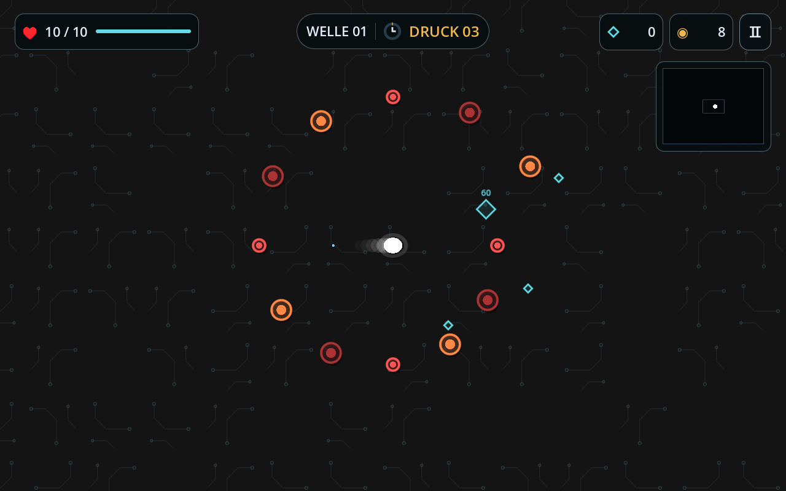
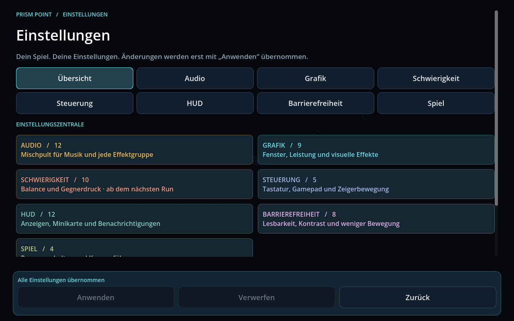
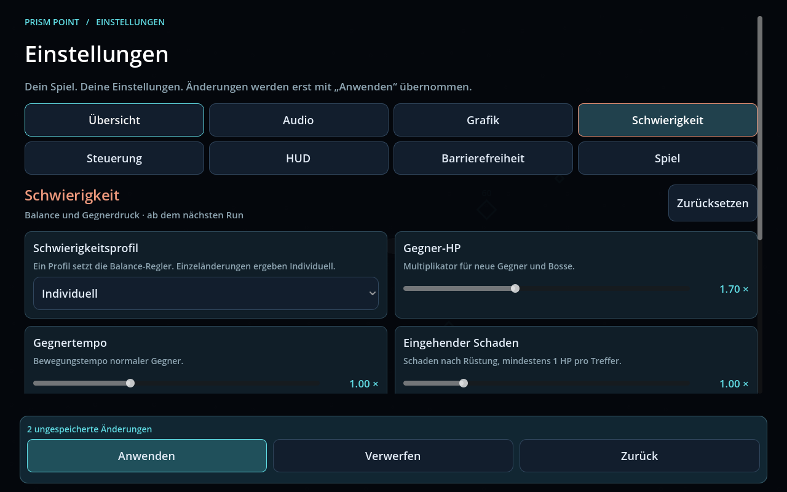
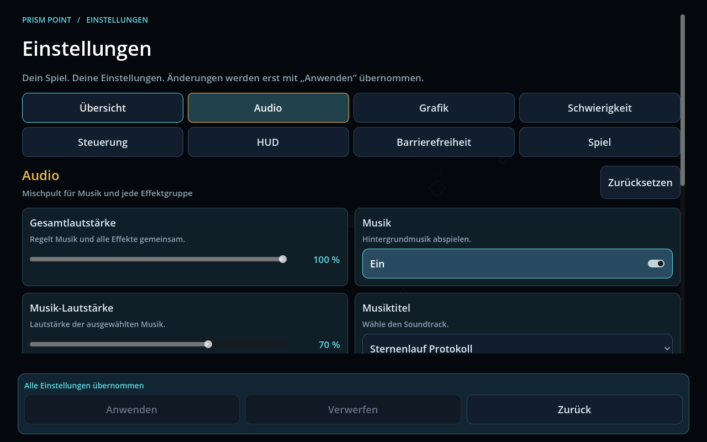
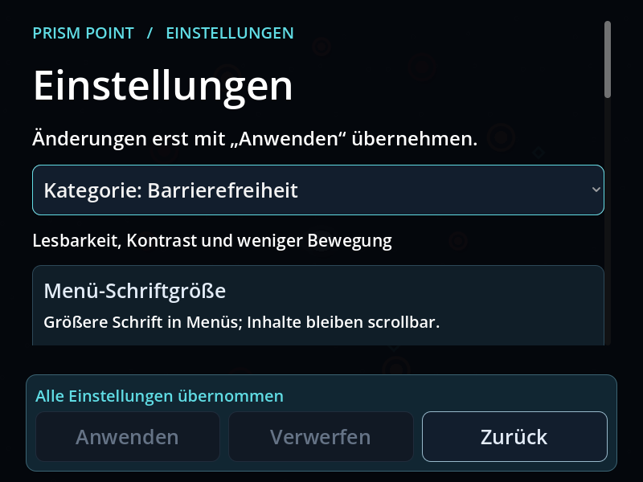

# Shopsuche und Einstellungszentrale

Dieser Bericht beschreibt den vorherigen Stand. Das
[Performance-Update](PERFORMANCE_UPDATE.md) ersetzt die mengenbasierte
Eskalation durch HP und langsam steigendes Tempo und ergänzt dessen Regler.

## Shop suchen unter steigendem Druck

Die Weglinie zum Shop ist aus der Arena und der Minikarte entfernt. Der Shop
bleibt an einem erreichbaren Ort und wird auf der Karte erst beim Erkunden
sichtbar. Nach Ablauf der Wellenzeit wird er aktiviert; ein Boss-Sieg aktiviert
ihn ebenfalls, anstatt den Spieler direkt ins Shop-Menü zu versetzen.

Während der Suche erscheinen weiterhin Gegner. Sofort bei Aktivierung beginnt
Stufe 1 mit **×1,5** Gegnerdruck. Alle **7,5 Sekunden** steigt der Faktor erneut:

| Zeit nach Aktivierung | Stufe | Gegnerzahl und HP | Spawnintervall |
| --- | --- | --- | --- |
| 0 Sekunden | 1 | ×1,5 | Basis ÷ 1,5 |
| 7,5 Sekunden | 2 | ×2,25 | Basis ÷ 2,25 |
| 15 Sekunden | 3 | ×3,375 | Basis ÷ 3,375 |
| 22,5 Sekunden | 4 | ×5,0625 | Basis ÷ 5,0625 |

Die Gegnerzahl pro Spawn wird aufgerundet. Neue Gegner erhalten den aktuellen
HP-Faktor. Bereits vorhandene Gegner wachsen ebenfalls; der Anteil bereits
verlorener HP bleibt erhalten. Dadurch ist langes Farmen zunehmend schwerer.
Die Anzeige wechselt von der Wellenzeit zu **DRUCK** und der aktuellen Stufe.

Pause, Einstellungen und das eigentliche Shop-Menü halten die Eskalation an.
Eine neue Welle setzt sie zurück. Vor einem Boss-Sieg startet sie nicht.
Für berechenbare Last sind aktive Gegner einschließlich Spawn-Warnungen auf
160 und das Spawnintervall auf mindestens 0,04 Sekunden begrenzt. HP wachsen
weiter; der Zahlenfaktor bleibt aus technischen Gründen höchstens 10¹².
Die Standardbalance verwendet 7,5 Sekunden und ×1,5; eigene Runs können diese
Werte in den Schwierigkeitseinstellungen ändern.

## 60 Einstellungen und sechs Tastenbelegungen

Die neue Oberfläche gliedert die Optionen in sieben Themenbereiche. Jede
Einstellung ist an die tatsächliche Spielfunktion angeschlossen.

| Bereich | Beispiele |
| --- | --- |
| Audio | Gesamtpegel, Musik und Titel, Effekte, separate Pegel für Schüsse, Treffer/Kills, Aufsammeln, Schaden/Bosse und Menü-Klicks; Hintergrund-Stummschaltung |
| Grafik | Fenster/Vollbild, Fenstergröße, VSync, FPS-Limit, Partikel, Spielerspur, Leuchteffekte, Schaltkreis-Kontrast, Erschütterung |
| Schwierigkeit | Entspannt/Standard/Fordernd/Individuell; Gegner-HP, Tempo, Schaden, Anzahl, Spawn-Häufigkeit, Herzen, Wellenlänge und Eskalation |
| Steuerung | Sechs Tastenbelegungen, Gamepad-Bewegung, Stick-Totzone, Maus/Touch, Ziehempfindlichkeit, weiche oder direkte Bewegung |
| HUD | Größe, Deckkraft, HP, Welle/Timer, Punkte/Gold, Minikarte und deren Größe, Gegner-/Bossbalken, Kill-Zahlen, Punktwerte und Hinweise |
| Barrierefreiheit | Menüschrift bis 140%, hoher Kontrast, Gegnerkonturen, Spieler-Markierung, reduzierte Bewegung, Trefferblinken, statischer Nebel und Gefahrenbeschriftung |
| Spiel | Hintergrund-Pause, Kameraführung, Spawn-Warnungen und Neustartbestätigung |

## Anwenden und Verwerfen

Änderungen werden zunächst in einem Entwurf gesammelt. Der Entwurf bleibt beim
Wechseln zwischen Kategorien erhalten. Die Leiste am unteren Rand bleibt auch
beim Scrollen sichtbar und zeigt die Zahl der offenen Änderungen.

- **Anwenden:** Alle Änderungen gemeinsam speichern und übernehmen.
- **Verwerfen:** Zum zuletzt übernommenen Stand zurückkehren.
- **Zurück:** Bei offenen Änderungen zwischen Übernehmen, Verwerfen und
  Weiterbearbeiten wählen.
- **Zurücksetzen:** Die aktuelle Kategorie auf Standard setzen; anschließend
  anwenden oder verwerfen. In der Übersicht können alle Einstellungen
  zurückgesetzt werden. Spielfortschritt und Freischaltungen bleiben erhalten.

Bei einem Speicherfehler bleiben der bisherige Stand und der bearbeitbare
Entwurf erhalten. Tasten werden erst beim Anwenden neu belegt; doppelte
Belegungen und reservierte Alternativtasten werden abgefangen.

Audio, Grafik, Steuerung, HUD und Barrierefreiheit wirken nach dem Anwenden.
Schwierigkeitswerte werden **beim nächsten neuen Run** übernommen, damit sich
die Balance nicht unvermittelt im laufenden Kampf ändert. Der Nebel-Modifikator
verdeckt das HUD auch dann, wenn dessen Anzeigen in den Optionen aktiviert sind.

## Kleine Fenster und große Schrift

Die Inhalte bleiben scrollbar. Kleine Fenster verwenden eine kompakte
Kategorieauswahl statt acht breiter Reiter. Bei größerer Schrift wechseln die
Einstellungsfelder in eine Spalte. Anwenden, Verwerfen und Zurück bleiben am
unteren Rand erreichbar.

## Verifikation

Godot 4.6.3: **214 Checks bestanden**, keine Engine- oder Scriptfehler.
Darunter sind 62 neue Prüfungen für die Eskalation und das Einstellungsverhalten.
Der Speicherfehlertest erzeugt absichtlich eine abgefangene Warnung.
Die gezeigten Bilder stammen aus dem echten Godot-Renderer. Das exportierte
Ressourcenpaket wurde außerhalb des Projektverzeichnisses gestartet und mit
neuen Einstellungen geprüft. Physische Gamepads, hörbare Audioausgabe und
plattformabhängiges Vollbild/VSync sind hier weiterhin nicht vollständig geprüft.
