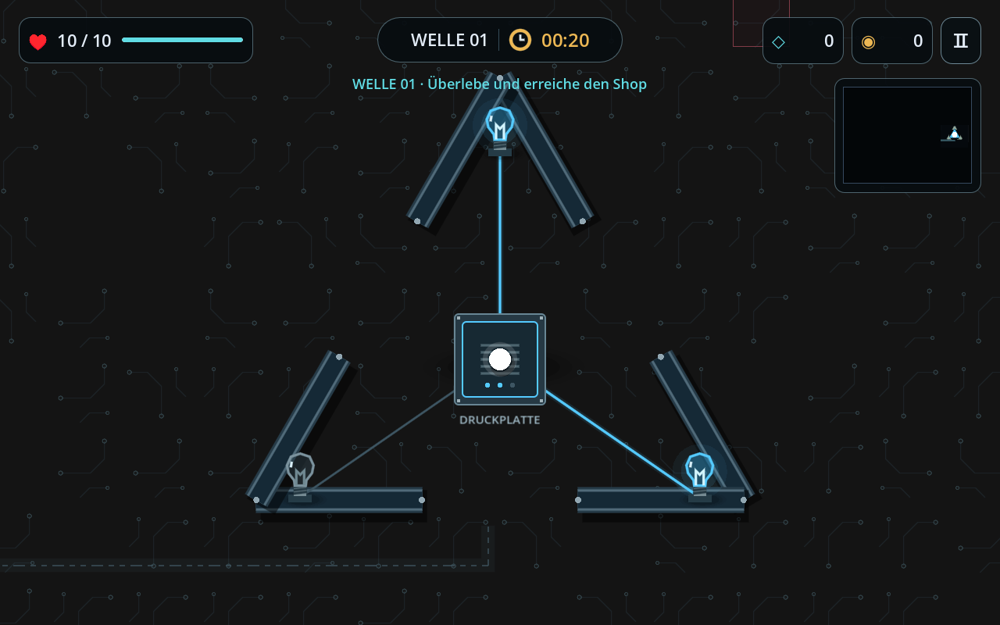
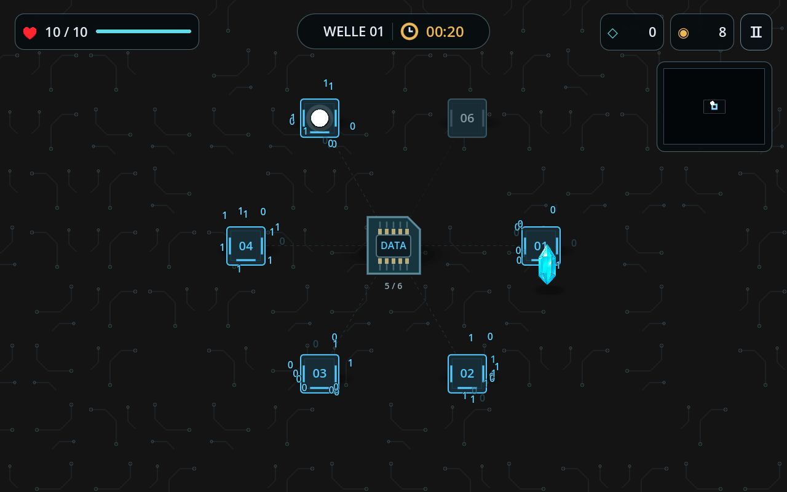
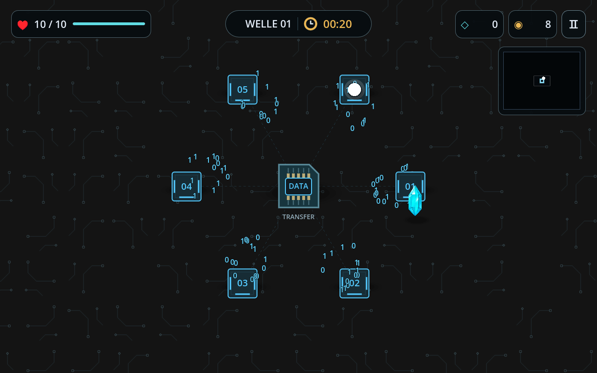
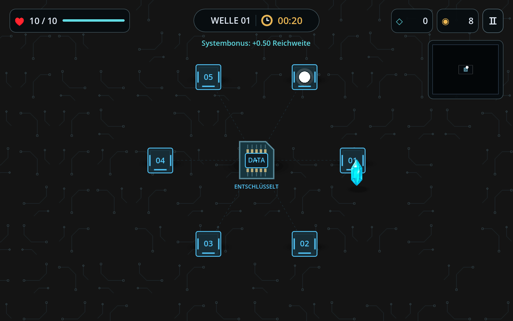

# Elektronik statt Monumente

## Schaltmodul mit Druckplatte und Glühbirnen

Das Alte Monument ist jetzt ein technisches Modul. Die begehbaren Eingänge
bleiben; Steinoptik und grüne Flammen wurden durch Metall, Leiterbahnen und
drei Glühbirnen ersetzt. In der Mitte befindet sich eine echte Druckplatte.

Beim Stehen auf der Platte wächst die blaue Ladung von der Platte entlang
jeder dünnen Verbindung zur jeweiligen Birne. Erst wenn die Ladung ankommt,
leuchtet die Birne blau. Die drei Zweige laden nacheinander über insgesamt
2,4 Sekunden. Beim Verlassen der Platte sinkt die Ladung wieder. Nach dem
Abschluss bleiben alle Lampen an und die bisherige Auswahl an Run-Boni bzw.
Risiken wird als Systemmodifikation angeboten.

## Datenchip und sechs Entschlüsselungsfelder

Der mittlere Fels wurde durch einen Datenchip ersetzt. Die sechs Felder sind
jetzt **240 statt 135 Weltpixel** vom Zentrum entfernt. Ihre Positionen werden
beim Erzeugen auf freie, erreichbare und ungefährliche Flächen geprüft.

Beim Darüberlaufen aktiviert sich ein Feld. Darum entstehen langsam ein- und
ausblendende Nullen und Einsen. Wiederholtes Betreten zählt dasselbe Feld nicht
doppelt. Nach allen sechs Feldern fliegen die Binärzahlen in einem **1,2 Sekunden**
langen Transfer zum Chip. Erst danach wird der bisherige zufällige Stat-Bonus
genau einmal vergeben. Während einer Pause stehen auch die Animationen still.

## Schaltkreis-Boden

Die Steinplatten sind durch kleine, dezente Leiterbahnen und Kontaktpunkte
ersetzt. Die Grundfarbe ist exakt **#141414**. Die Farbe wurde auch am gerenderten
Bild geprüft: Der häufigste Hintergrundpixel ist RGB(20, 20, 20).

Die 6000×4500-Arena, HP-Regeln, Kristallfundorte und das schlanke HUD bleiben
erhalten. Die Minikarte zeigt entdeckte Schaltmodule und Chips mit blauen Symbolen.

## Prüfung

121 automatisierte Checks bestanden: 52 Basisprüfungen und 69 Regressionen.
Unter anderem geprüft: Druckplatten-Grenze, Ladefortschritt, Lampenstatus,
Feldabstand, 0/1-Zeichen, Transferbewegung, verzögerter Bonus und Auszahlung
nur einmal. Druckplatte, Datenfelder, Transfer und Abschluss wurden außerdem
mit echtem OpenGL-Rendering kontrolliert.
