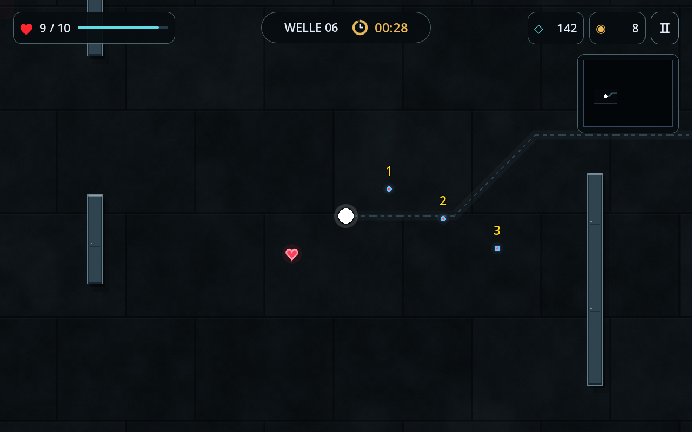
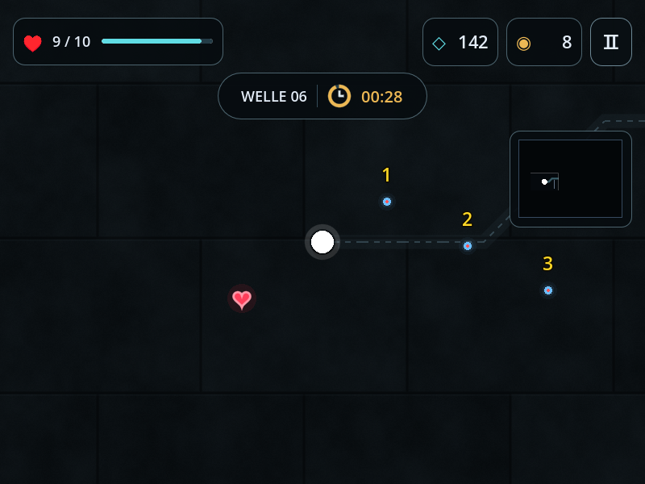

# Minimalistische UI mit taktischer Farbwelt

Die neue Spieloberfläche kombiniert die schmalen, schwebenden Module aus
Entwurf 1 mit der Schiefer-/Stahl-Farbwelt und dem etwas realistischeren
Hintergrund aus Entwurf 5.

- Getrennte Lebens-, Wellen-/Timer-, Punkte-/Gold- und Pause-Module statt
  eines durchgehenden schwarzen Balkens.
- Kühle Blau-/Stahlgrautöne, Cyan für Leben und Punkte, warmes Amber für
  Countdown und Gold. Schmale Konturen, dezente Rundungen und weniger Fläche.
- Prozedurale Steinplatten mit feiner Körnung, Fugen und zurückhaltender
  Abnutzung. Metallwände mit Schatten, Kanten, Fugen und kleinen Nieten.
- Minikarte mit dezentem Rahmen; bei schmalen Fenstern wird das Wellenmodul
  unter die restlichen Anzeigen gesetzt, statt sie zu überdecken.
- Der blaue Richtungs-/Waffenstrich am Spieler wurde entfernt. Bewegung,
  Schießen und Dash funktionieren weiterhin.
- Kill-Popups enthalten nur die gelbe Zahl – weder „Combo“ noch „ד.
- Die vorhandenen Regeln bleiben erhalten: Statuswerte nur in der Pause,
  versteckte Anzeigen bei Nebel und HP-Übernahme zwischen Wellen.

## Echte Godot-Vorschau

101 automatisierte Prüfungen bestanden (52 Basisprüfungen und 49 Regressionen).
Darunter Datenanzeige und überlappungsfreies HUD bei beiden Fenstergrößen.
Die Material-Shader und die Darstellung wurden mit OpenGL/llvmpipe geprüft.
