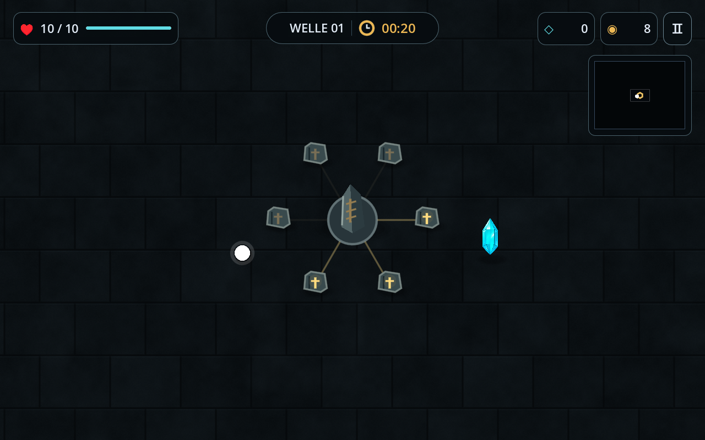
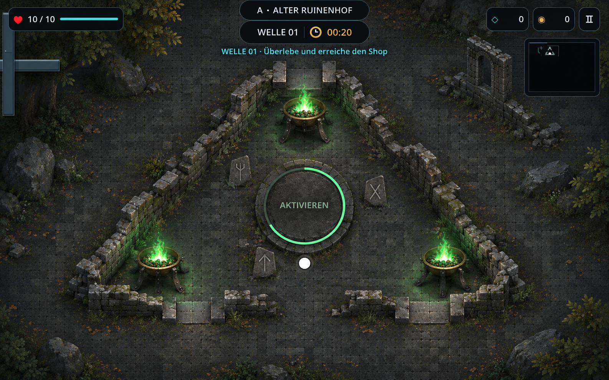
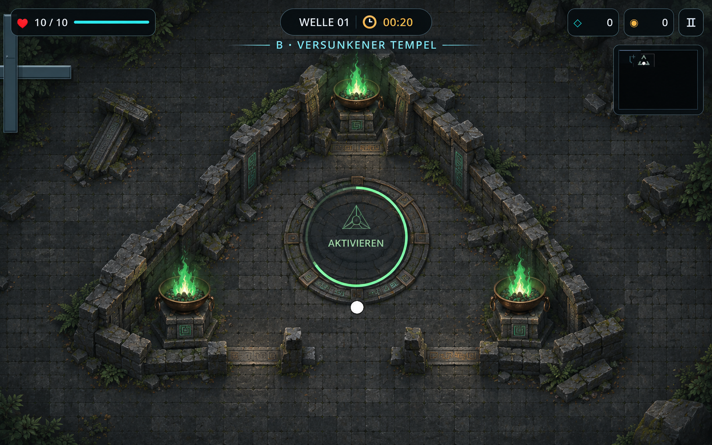
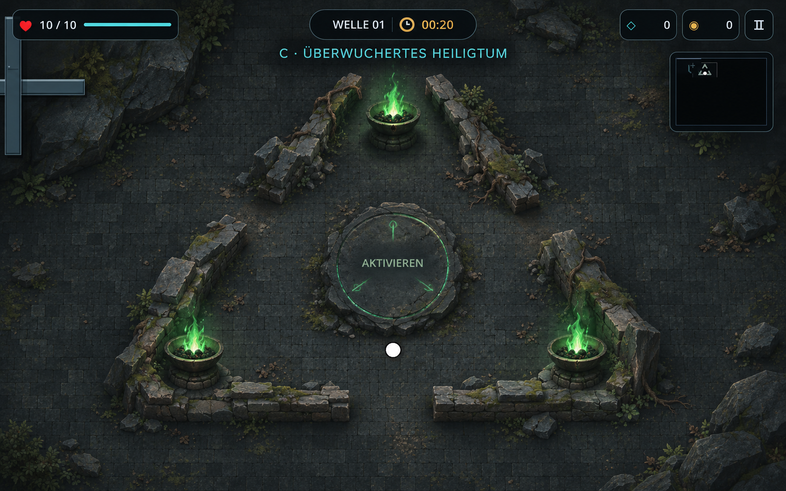

# Karte, Kristall und Monumente

Historischer Zwischenstand: Die damaligen Stein- und Feuerschalen-Entwürfe wurden
durch das [aktuelle Elektronik-Update](TECH_UPDATE.md) ersetzt.

## Bereits im Spiel

- **6000×4500** statt 4800×3600 Weltpixel: +25% Breite und Höhe, rund 56% mehr
  Fläche. Navigation, Kamera, Aufdeckung, Wände und Boden passen dazu.
- Bodenplatten von 256×192 auf **128×96** verkleinert.
- Überarbeiteter schwebender Kristall: Gezeichnet wird nur die Gemmensilhouette,
  ohne runden Sockel oder Hintergrund. Ein separater weicher Schatten liegt auf
  dem Boden. Der Kristall erscheint weiterhin mit 70% Wahrscheinlichkeit,
  jetzt aber an freien Stellen der Karte mindestens 500 Weltpixel vom Shop entfernt.
- Normales Monument als Runenobelisk mit sechs kleinen Stein-Satelliten.
  Darüberlaufen und Stat-Bonus nach allen sechs Aktivierungen bleiben unverändert.
- Entdeckte Monumente auf der Minikarte: grünes Dreieck für das Alte Monument,
  goldene Rune für das normale. Benutzte Symbole sind gedimmt. Unbekannte
  Regionen werden nicht vorzeitig aufgedeckt; bei Nebel bleibt die Karte verborgen.

111 automatisierte Prüfungen bestanden (52 Basisprüfungen und 59 Regressionen).
Die neuen Tests prüfen die größere Karte, Kristall-Verteilung, Entdeckung und
Monument-Aktivierung. Die Darstellung wurde mit OpenGL geprüft.

## Altes Monument: Beispiele zur Auswahl

Die folgenden Bilder sind generierte **Design-Entwürfe**, keine Screenshots
der Implementierung. Das Alte Monument bleibt bis zur Auswahl einer Richtung
unverändert. Drei Eingänge, grüne Flammen und Aktivierung im Inneren bleiben
bei der späteren Überarbeitung erhalten.

### A – Alter Ruinenhof

Raue Granitblöcke und eiserne Feuerschalen auf kurzen Füßen.

### B – Versunkener Tempel

Bearbeiteter Basalt, bronzene Feuerschalen auf Sockeln und Jade-Runen.

### C – Überwuchertes Heiligtum

Gebrochene Mauern, Moos und Wurzeln mit schweren Steinschalen.

